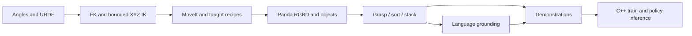

# RoboFlex to Panda: a C++ robotics learning path

Build an arm application in seven modules, progressing from motor angles and robot geometry to MoveIt, depth perception, language commands, and learning actions from demonstrations. Application nodes, kinematics, task execution, recording, training, and inference are C++17. Launch files are Python orchestration only. Every ROS package uses `ament_cmake`.

**Real RoboFlex ends at Module 3. Modules 4–7 use Panda in Gazebo only.** The real motors accept angles without reporting measured joint positions. The existing command-derived state and hard limits are retained. Controller completion on RoboFlex means commands completed, not encoder-confirmed arrival.

## Progression

**Start with [the 17 runnable project guides](PROJECTS.md).** Each project has its own README with terminal setup, exact launch/client commands, expected results and shutdown instructions. The [README runner](tools/run_project.sh) executes those same commands and saves evidence. See [the execution report](resources/README_RUN_REPORT.md) for measured results.

| Module | Build and demonstrate | Robot | Read next |
|---|---|---|---|
| 1 — Connection and task space | Existing PlatformIO path, URDF, joint angles, bounds, workspace sampling, one-joint commands | RoboFlex display/mock/Gazebo; existing hardware optional | [Module 1](01_connection_and_task_space/README.md) |
| 2 — Kinematics and XYZ motion | Robot-specific DH, FK, Jacobian, bounded position IK, timed controller goals without MoveIt | Same RoboFlex model | [Module 2](02_kinematics_and_control/README.md) |
| 3 — MoveIt and taught manipulation | Planning, execution, named/saved poses, C++ recipes, gripper and taught pick/place | RoboFlex mock/Gazebo and existing real stack | [Module 3](03_moveit_and_pick_place/README.md) |
| 4 — Depth perception and picking | Simulated RGBD, coordinate transforms, filtering, cube segmentation, collision objects, pick verification | Panda simulation | [Module 4](04_roboflex_depth_perception/README.md) |
| 5 — Manipulation projects | Colour sorting, three-cube stacking, grasp-yaw comparison, randomized resets, CSV results | Panda simulation | [Module 5](05_panda_depth_manipulation/README.md) |
| 6 — Language-guided tasks | Rules baseline, local small LLM, optional VLM image grounding, validated structured commands | Panda simulation | [Module 6](06_language_guided_tasks/README.md) |
| 7 — Demonstrations and VLA foundations | RGB/language/state datasets, native C++ behavior cloning, checkpoint, held-out evaluation, bounded inference | Panda simulation | [Module 7](07_demonstrations_and_vla/README.md) |

Module 7 implements an educational vision-language-action policy: a small neural network conditioned on RGB, a colour instruction and a destination. It is not a pretrained foundation VLA or a port of SmolVLA. The full collect → train → evaluate → infer loop is inspectable C++.

## Setup and build

Baseline: Ubuntu 24.04, ROS 2 Jazzy, Gazebo Harmonic. Source an existing ROS install and install missing declared dependencies with rosdep. Review rosdep output before installing system packages.

```bash
cd /home/luqman/repos/RoboFlexv2.1
source /opt/ros/jazzy/setup.bash
rosdep install --from-paths 'Learning Path' roboflex_ros2/roboflex_description \
  roboflex_ros2/roboflex_control roboflex_ros2/roboflex_moveit \
  --ignore-src --skip-keys warehouse_ros_mongo -r -y
bash 'Learning Path/tools/build.sh'
source 'Learning Path/tools/setup.bash'
bash 'Learning Path/tools/checks.sh'
```

The unused warehouse database is skipped; this course stores poses in YAML.

`build.sh` builds the repository's working robot dependencies into `install/course_base` and the nine course packages into `install/learning`. It does not flash firmware or start hardware. The setup script defaults to ROS domain 81 and local discovery; if you already exported a domain it preserves it. Use a fresh terminal for course work so an existing hardware domain is not inherited accidentally.

For every second terminal:

```bash
cd /home/luqman/repos/RoboFlexv2.1
export ROS_DOMAIN_ID=81
source 'Learning Path/tools/setup.bash'
```

Use one backend per ROS domain. Stop the current module's launch before starting a launch that includes another backend. Modules 4–7 share one Panda workcell; clients attach to that workcell. `headless:=true rviz:=false` runs without GUI. Simulation does not need physical camera calibration: the camera pose and intrinsics are specified, and frame transforms are still necessary.

## Teaching method

Each module follows: inspect the existing model/configuration → launch one backend → run a focused C++ node → observe topics/action feedback → change one parameter → diagnose a failure → complete a project. Nodes have explicit responsibilities. Configuration goes into YAML or launch parameters, and clients use typed actions rather than embedding robot drivers.

Read code in this order:

1. [Shared interfaces](shared/arm_course_interfaces/README.md): observations and task/action contracts.
2. [Shared core](shared/arm_course_core/README.md): URDF-derived geometry, state freshness, bounded trajectories.
3. The current module's launch file, its server/node, then its client.
4. The module exercises and completion evidence before advancing.



## Existing code reused

- `roboflex_pio`: production PlatformIO firmware, angle mapping and ARM/HOLD behavior.
- `roboflex_description/urdf/real_hardware.urdf.xacro`: canonical real-robot geometry and joint limits.
- `roboflex_control`: existing transport hardware interface, controller configuration and bringup. No second UDP driver is introduced.
- `roboflex_moveit`: existing SRDF, kinematics, OMPL and controller setup.
- Panda geometry/SRDF come from installed `moveit_resources_panda_*`; this course supplies its Gazebo world, controllers, camera, bridge, C++ tasks and learning code.

All course source is under this directory. The historical Module 4 folder name remains for link compatibility; its implementation now uses **Panda simulation**, matching the revised hardware boundary.

## Features and topics in order

- Joint coordinates, task coordinates, reachable workspace, hard limits, units, commanded versus simulated state.
- URDF/Xacro, frames/TF, DH with base/tool transforms, FK, Jacobian, underactuation, bounded numerical IK, singularities, trajectory timing.
- ROS 2 actions, node ownership, controller interfaces, MoveIt planning scene, collision checking, plan/execute, saved poses, YAML task recipes.
- RGBD rendering, camera conventions, voxel filtering, ROI, colour clusters, estimated geometry, scene updates, freshness and ambiguity rejection.
- Pregrasp/approach/close/lift/transfer/release/retreat, contact rules, grasp alternatives, physical outcome verification, reset/repeat/evaluate.
- Text-to-JSON, LLM/VLM grounding, constrained schema, reference resolution, deterministic execution.
- Demonstrations, action timing, episode splits, normalization, behavior cloning, Adam, model serialization, latency, distribution shift and rollout evaluation.

## Corrections to the original plan

1. No feedback is available on RoboFlex. Existing reported state remains a command estimate; saving a pose saves that estimate. Simulation has measured simulator state.
2. Four arm joints cannot generally satisfy arbitrary six-dimensional poses. Module 2 solves XYZ only; tool orientation follows the solution. Panda supports full pose tasks.
3. Module 2 reuses the functioning hardware interface instead of replacing it. IK does not itself perform collision-free planning; that is introduced in Module 3.
4. DH is derived from this model, not borrowed from Panda. Rounded nearly parallel CAD axes require a documented numerical approximation; runtime FK uses the original URDF/KDL chain.
5. A planning-scene attachment does not physically hold a Gazebo object. Pick success requires measured simulated lift and placement.
6. “Pick whatever it sees” is narrowed to supported coloured cubes and reachable destinations. General object segmentation and novel-object grasps are separate research problems.
7. Language interpretation plus MoveIt is distinct from a learned action policy. Both are implemented as separate lessons.

See [resources](resources/README.md) and [validation](resources/VALIDATION.md) for references, verified results and remaining practical limitations.
